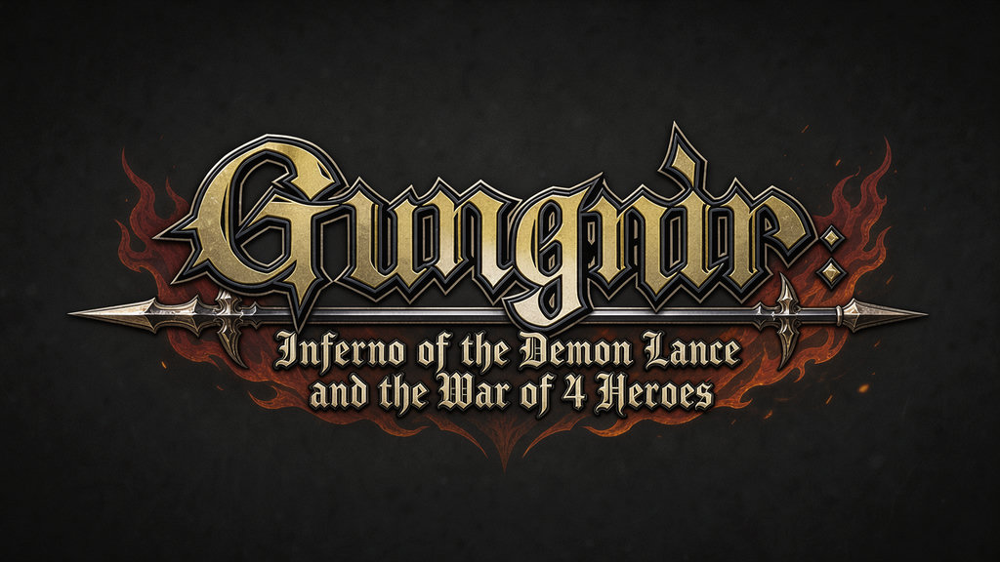

# gungnir-recomp

Static recompilation of **Gungnir: Inferno of the Demon Lance and the War of
Heroes** (PSP, USA — ULUS-10592) to native C++, targeting **Android**.

**Bring your own game.** This repository contains no game data, no game code
(including no generated/translated game code), no keys, no firmware, and no
driver binaries.

## Status

Playable into real battles on an adb-connected device (touch + gamepad);
formal milestone QA still pending. Master plan: [`.dex/plan.md`](.dex/plan.md)
— tasks T1–T18, milestones M0–M5. Current focus: battle-scene performance
(texture-hash hotspot fixed, versioned texture cache next) and the M4
milestone QA records.

| Milestone | Meaning | State |
|---|---|---|
| M0 | Repo live, IP policy enforced | **closed** (T1+T2+T3; ledger: `data/milestones.json`) |
| M1 | Recomp pipeline proven on synthetic fixtures (Linux) | **closed** (T4; `data/milestones.json`) |
| M2 | Gungnir analyzed, AOT generated locally | **closed** (T5; `data/milestones.json`) |
| M3 | Bounded boot on Linux desktop | **closed** (T6+T7; ledger: `data/milestones.json`) |
| M4 | **Title screen on adb device** | **in progress** (title, menus, and real gameplay into battles verified on device, including an in-game save/load round trip; milestone QA records pending) |
| M5 | Hardening: audio, saves, texture upscaling, driver picker, perf | **in progress** (memory-stick saves and host save states working; battle BGM/stall fixes in; perf profiling ongoing) |

Analysis details and the current census: [`docs/ANALYSIS.md`](docs/ANALYSIS.md);
bring-up findings journal: [`docs/BRINGUP.md`](docs/BRINGUP.md).

## Custom Adreno drivers

Gungnir can load a user-supplied Mesa Turnip/Qualcomm Vulkan ICD package on
arm64 Android through libadrenotools. See [`docs/ANDROID_DRIVERS.md`](docs/ANDROID_DRIVERS.md).

## Building

The full from-scratch flow — intake, decryption, analysis, codegen, host
tests, Android build and device run — is in
[`docs/BUILDING.md`](docs/BUILDING.md). Android shell setup and deploy are in
[`docs/ANDROID.md`](docs/ANDROID.md)

**Have a `.chd`?** The pipeline's input is a UMD **ISO** — converters, the
identity gate, and the full intake flow live in
[`docs/INTAKE.md`](docs/INTAKE.md). `game.chd`/`game.iso` are gitignored and
never committed.

## License

Project-original code: [GPL-3.0-or-later](LICENSE). Third-party components
are pinned, digest-verified and attributed (`dependencies.json`, the
generated `THIRD_PARTY_NOTICES.txt`, `docs/SOURCE_PROVENANCE.md`); vendored
code carries its license in-tree (`third_party/*/LICENSE`).
